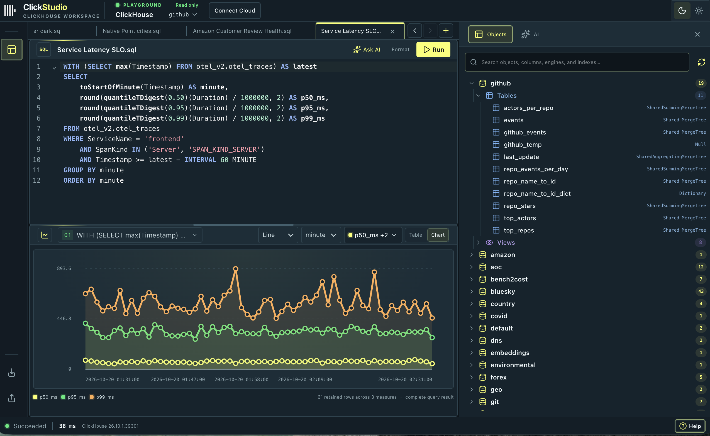

# ClickHouse Playground

A SQL workspace for ClickHouse. Write queries, explore data, inspect results, build charts, and review query runs.

[Open ClickHouse Playground](https://clickstudio-eight.vercel.app/)



## Features

- Write and run SQL, including multi-statement scripts.
- Browse databases, tables, columns, system docs, and MergeTree parts.
- Explore results, inspect values, build charts, and view query plans.
- Save query documents and revisit query runs.
- Import CSV, JSON, and NDJSON files.
- Connect to ClickHouse Playground or ClickHouse Cloud.
- Use the AI assistant and connect external tools through MCP.

## Run locally

Requires Node.js 22.12 or newer and npm.

```sh
npm run setup
cd clickstudio
npm run init:env
npm run dev
```

Open http://localhost:5173 and sign in with `CLICKSTUDIO_TOKEN` from `.env`.

## Full CSV downloads

Query results have a bounded preview (5,000 rows and 2 MB by default). **Download full result (.csv)** reruns the saved query and streams CSV without retaining the entire result in ClickStudio. The bundled local reader allows this export to bypass ClickHouse output-row and output-byte limits, while normal previews stay capped. Source-read limits, execution time, memory restrictions, and read-only permissions still apply.

Custom ClickHouse connections retain their existing server output limits. To enable full exports larger than those caps, set `CLICKHOUSE_FULL_EXPORT_UNBOUNDED=true` for a single local environment connection or `"fullExportUnbounded": true` on the corresponding `CONNECTIONS_FILE` profile. Only opt in when the ClickHouse user allows `max_result_rows=0` and `max_result_bytes=0` in read-only mode. Exports fail if an enforced server limit is exceeded, and rerunning SQL can return data that has changed since the preview.
