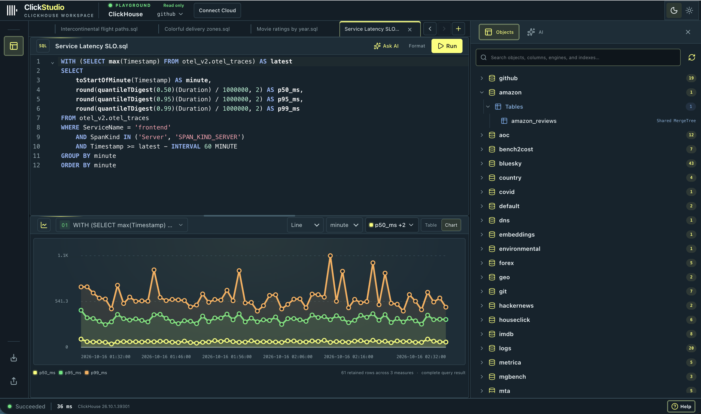

# ClickStudio

A SQL workspace for ClickHouse. Write queries, explore data, inspect results, build charts, and review query runs.

[Open ClickStudio](https://clickstudio-eight.vercel.app/)



## Features

- Write and run SQL, including multi-statement scripts.
- Browse databases, tables, columns, system docs, and MergeTree parts.
- Explore results, inspect values, build charts, and view query plans.
- Save query documents and revisit query runs.
- Import CSV, JSON, and NDJSON files.
- Connect to ClickHouse Playground or ClickHouse Cloud.
- Use the AI assistant and connect external tools through MCP.

## Run locally

Requires Node.js 22.12 or newer and npm.

```sh
npm run setup
cd clickstudio
npm run init:env
npm run dev
```

Open http://localhost:5173 and sign in with `CLICKSTUDIO_TOKEN` from `.env`.
